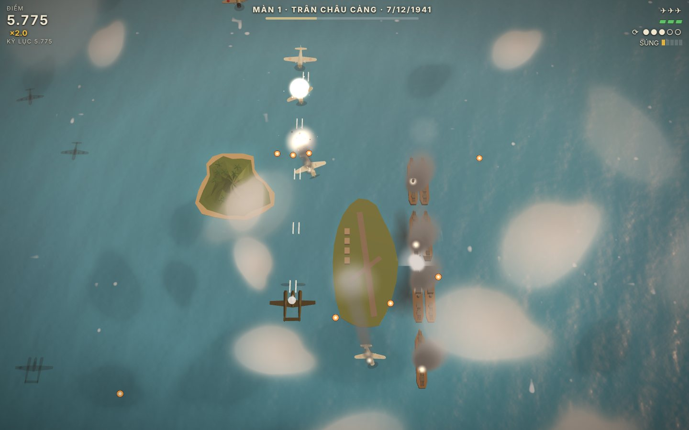
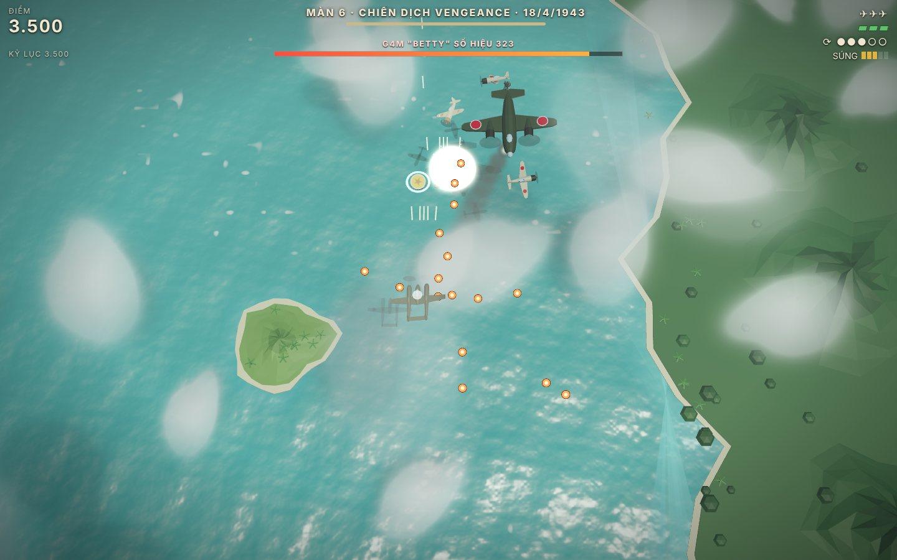
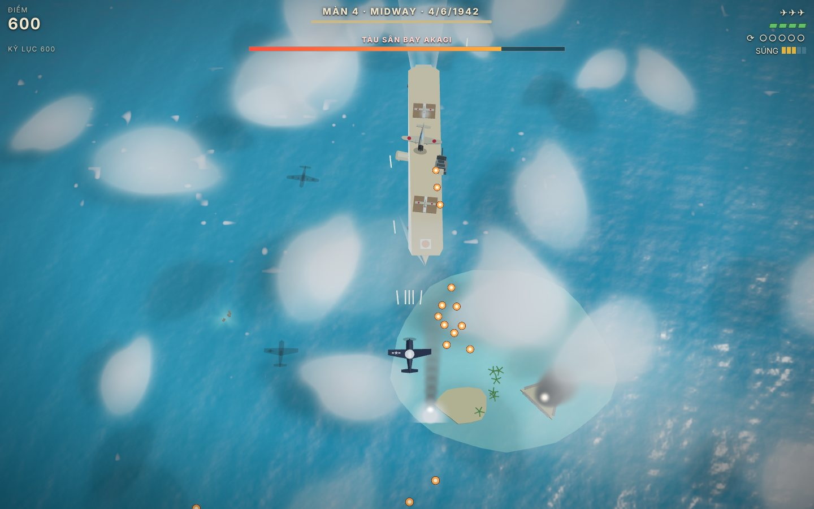
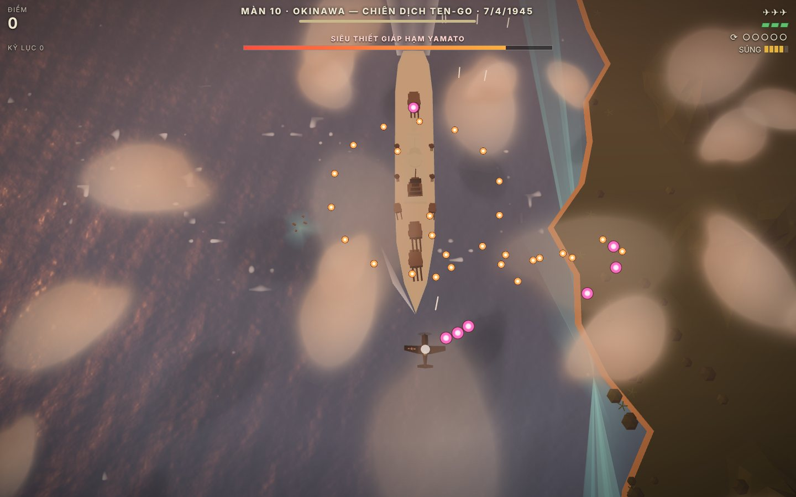

<!-- TODO(publish): replace <owner> with the GitHub account that hosts the repository, here and in package.json. -->

# Tater's Flight Sim

*The Tater Tots Flight Simulator* — a real flight simulator that runs in your web browser.

[](https://github.com/<owner>/tatertotsflightsim/actions/workflows/ci.yml)
[](LICENSE)

Fly a **Cessna 172RG**, an **F-16C**, an **A-10C Warthog** or a **Boeing 747-400** over a big
world of farmland, forests, rivers, towns, a coastline and snow-capped mountains. The flight
physics are real, so you can stall, spin and crash (the aircraft breaks apart). The jets carry
guns and missiles: bust tanks at the target range and shoot down enemy MiGs, Sukhois and Hind
helicopters. Every model, texture and sound is generated in code: nothing is downloaded while
you play, and the only runtime dependency is [Three.js](https://threejs.org).


## Gallery

| | |
| --- | --- |
|  |  |
| **Boeing 747-400** on final over the coast. | **The 747 flight deck**: six live glass displays, levers that move. |
|  |  |
| **Fox 2.** Lock an enemy jet with T, fire a Sidewinder with Z. | **Splash one.** Enemy aircraft break, burn and fall. |
|  |  |
| **Tank busting.** Lock and launch a Maverick. | **Direct hit.** Fireball, debris, and the blast takes out a neighbour. |
|  |  |
| **F-16C cockpit**: HUD on the glass, live MFDs. | **A-10C cockpit**: HUD on the glass, TAD map and targeting pod. |
|  |  |
| **Cessna 172RG cockpit**: a real 172RG panel. | **Tater Field**: two runways, a busy ramp. |
|  |  |
| **F-16C in afterburner** over the mountains. | **Low and slow** down the river to the sea. |

## Quick start

You need **Node.js 22.12 or newer** (any current LTS), **git**, and a browser with **WebGL2**
(Chrome, Edge, Firefox, or Safari 15 and later).

1. **Get the code:**
   ```sh
   git clone https://github.com/<owner>/tatertotsflightsim.git
   cd tatertotsflightsim
   ```
2. **Install:** `npm install`
3. **Start:** `npm start`, then open **http://127.0.0.1:8092** in your browser.

A loading screen shows while the world streams in; it fades by itself, or press any key or click
(that also turns the sound on). You start on runway 36 with the engine running at idle. Pick another
aircraft from the dropdown at the top right.

**macOS.** Install Node from [nodejs.org](https://nodejs.org), with `brew install node`, or with
[nvm](https://github.com/nvm-sh/nvm) (`nvm install` reads the version from `.nvmrc`). Run the
commands in Terminal.

**Linux.** Install Node with [nvm](https://github.com/nvm-sh/nvm) or your distribution's
NodeSource packages. The default `nodejs` package of some distributions is too old, so check with
`node --version`. Run the commands in a terminal.

**Windows.** Install Node from [nodejs.org](https://nodejs.org) (the LTS installer) or with
[nvm-windows](https://github.com/coreybutler/nvm-windows), and install
[Git for Windows](https://git-scm.com/download/win). Run the same commands in PowerShell, Windows
Terminal or Git Bash.

If port 8092 is taken, run `npx vite --port 5173` instead (any free port works). To play from
another device on your network, run `npx vite --host 0.0.0.0`.

## The aircraft

| Aircraft | What it's like | Speeds | Carries |
| --- | --- | --- | --- |
| **Cessna 172RG Cutlass** | A forgiving four-seat trainer with a 180 hp engine and retractable gear. Steam gauges, flaps, trim, P-factor, ground effect. The one to learn on. | Lifts off ~55 kt, stalls ~48 kt clean, cruises ~125 kt, never exceed 163 kt | Nothing |
| **F-16C Fighting Falcon** | A supersonic fighter. Fly-by-wire (9 g, 25° angle-of-attack limit, 300°/s rolls), afterburner, speed brake, jet HUD. Fast and unforgiving. | Rotates ~150 kt, lands ~145 kt, Mach 2 at 40,000 ft | M61A1 20 mm gun (511 rounds), 2 AGM-65 Mavericks, 2 AIM-9 Sidewinders |
| **A-10C Thunderbolt II** "Warthog" | A slow, tough tank killer with a big straight wing and two slow-spooling turbofans. Split "deceleron" speed brakes; the gun's recoil slows the jet down. | Rotates ~120 kt, stalls ~116 kt, tops out ~370 kt | GAU-8/A 30 mm gun (1,150 rounds), 4 AGM-65 Mavericks, 2 AIM-9 Sidewinders |
| **Boeing 747-400** | The "Queen of the Skies" in Tater Airways colours, flown light (~220 t) so it fits the 1,600 m runway. Four engines, 64 m of wing, 18 wheels, heavy and stately. A full glass flight deck (PFD, ND, EICAS) and an airliner-style on-screen display. | Rotates ~145 kt with flaps 10 after ~1 km, cruises Mach 0.85 at FL350, lands ~130 kt with flaps 30, limit 365 kt | Nothing |

All four have a 6-degrees-of-freedom flight model tuned against published numbers (the
calibration tables are at the top of `src/physics/aircraft.ts`).

## What you can do

- **Fly anywhere.** The world is tens of kilometres across, from the mountains in the north
  (peaks over 2,500 m) to the sea in the south. Take off, explore, and come back to land.
- **Four cameras and head look.** Cockpit, chase, fly-by and orbit (<kbd>1</kbd>–<kbd>4</kbd>, or
  <kbd>C</kbd> to cycle). Drag the mouse to look around the cockpit or orbit the aircraft; the
  wheel zooms.
- **Four times of day.** Morning, midday, golden hour and dawn (<kbd>N</kbd>), with a physically
  based sky, volumetric clouds and cloud shadows moving across the ground.
- **Stall, spin and recover.** Hold the nose up until the wing quits; add rudder and it spins.
  A stall warning sounds first.
- **Land on two runways.** Tater Field has runway **36/18** and the crosswind runway **03/21**,
  crossing it at 30°, with PAPIs, approach lights and a rotating beacon. Every touchdown is graded
  from *butter* to *hard*; land too hard, or with the gear up, and it ends badly. Start on any
  runway end with `?rwy=36`, `18`, `03` or `21`.
- **Crash.** Hit the ground, a tree or a building and the aircraft breaks apart in a fireball, and
  a crash camera follows the wreck. Pull too many g or dive past the limit and the airframe fails.
  Press <kbd>R</kbd> to try again.
- **Shoot the gun** (F-16, A-10). Rounds fly real ballistic paths, and the HUD's CCIP pipper shows
  where they'll land. Tank armour is thick at the front and thin on top and behind.
- **Fire missiles** (F-16, A-10). Point the nose at a target and press <kbd>T</kbd> to lock, then
  <kbd>Z</kbd> to fire: an **AGM-65 Maverick** at a ground vehicle, an **AIM-9 Sidewinder** at an
  aircraft. The missiles are deliberately **arcade**: they fly a scripted path to the locked
  target, with no real guidance model. A picture-in-picture view shows the Maverick's target.
- **Bust tanks at the range.** North of the airport, 23 vehicles (T-72B tanks, BMP-2s, BTR-80s,
  Ural trucks and ZSU-23-4 Shilkas): a platoon in revetments, a logistics park, and a convoy that
  drives the farm lanes and scatters when you attack. Wrecks burn, and T-72 turrets get tossed.
- **Shoot down enemy aircraft.** MiG-29 fighters fly patrols around the range, Su-25s make attack
  passes, and Mi-24 helicopters circle low. They break and pop flares when you lock them, fall
  burning when hit, and a replacement arrives a minute later. They never shoot back.
- **See a living world.** Taterville, the coastal city of Port Chateau and two dozen villages
  and hamlets (about 11,000 buildings and 19,000 garden and street trees), roads with moving and
  parked cars, a river running from the mountains to the sea, lakes, surf on the beaches, a
  marina, sailing yachts, a ferry, a container ship and a tanker with wakes, light aircraft in the
  circuit and airliners with contrails overhead. Tater Field itself has a tower, hangars, a
  flight school, a fire station, a fuel farm and dozens of parked aircraft.
- **Hear it.** Every sound is synthesised in the browser: piston, jet and turbofan engines,
  afterburner, wind, stall and gear horns, tyres, crashes, explosions, and the GAU-8's "BRRRT"
  (heard late from outside, at the speed of sound).

### Your first flight (Cessna)

Push the throttle up with <kbd>W</kbd> and let the speed build. At about **55 knots**, hold
<kbd>↓</kbd> to lift the nose to about 9°, keep it there until about 70 knots, then relax. Raise
the gear with <kbd>G</kbd> once you're climbing. At full power a real 172 needs a little **right
rudder** (<kbd>D</kbd>). To practise landing, press <kbd>Shift</kbd>+<kbd>R</kbd>: you start on a
3° final approach to runway 36 at 72 knots with the gear down and flaps 20. Over the runway, close
the throttle and raise the nose gently to flare. If the gear is up with the power back, the
**GEAR** horn sounds.

**F-16.** Push the throttle past about **90 %** to light the **afterburner**. Rotate at about
150 knots. <kbd>X</kbd> toggles the **speed brake**. Keep an eye on the angle of attack when you
pull hard.

**747.** Everything happens slowly. Set flaps 10 (two presses of F), full power, and rotate
gently at about 145 knots: yank the yoke and you'll scrape the tail. Raise the gear, clean up the
flaps as it accelerates, and fly it with small, early inputs. To land, Shift+R puts you on final
with flaps 30; aim for about 130 knots over the threshold. The spoilers deploy by themselves on
touchdown. Use the whole runway.

### Combat (F-16 and A-10)

The target range is **north of the airport**: take off from runway 36 and keep going. The **RANGE**
cue on the HUD (a caret on the heading tape and a ▽ on the ground) points to it and shows the
distance. To start right there, add `?aircraft=a10&spawn=range` to the address.

- **Gun.** Hold <kbd>Q</kbd> (or <kbd>Enter</kbd>). The barrels need a moment to spin up. Put the
  **CCIP pipper** (the circle with a dot) on the target and fire when it shows **IN RNG** (inside
  4,000 ft). Against aircraft, the HUD shows a gun lead circle.
- **Missiles.** Point the nose at a vehicle or an aircraft and press <kbd>T</kbd>; press it again
  for the next target. When the box turns solid and **LOCK** shows, press <kbd>Z</kbd>. The HUD
  counts your rounds, Mavericks, Sidewinders and **kills**, and every kill pops up a message such
  as "T-72B destroyed — GAU-8".

## Pacific 1942: Bắn Máy Bay (the arcade game)

The repository has a second game: **Pacific 1942 — Bắn Máy Bay** ("shoot down the planes"), a
ten-level vertical-scrolling shooter set in the Pacific War, in Vietnamese. Fly a **P-38
Lightning**, **F6F Hellcat** or **F4U Corsair** from Pearl Harbor (7 December 1941) to the sinking
of the Yamato (7 April 1945): Wake, Coral Sea, Midway, Guadalcanal at night, the interception of
Yamamoto's G4M over Bougainville, the Philippine Sea, Leyte Gulf in the rain, Iwo Jima and Okinawa,
each with a historical briefing and a boss — carriers that launch aircraft, battleships with
turrets to knock out one by one, a flying boat, the Suribachi fortress. Same stack as the
simulator (Three.js, every model and sound made in code), its own page:

- `npm start`, then open **http://127.0.0.1:8092/pacific.html** (the build puts it in `dist/` too).
  `npm run build:pacific-file` makes a single HTML file that plays offline, opened from disk.
- Arrows or <kbd>W</kbd> <kbd>A</kbd> <kbd>S</kbd> <kbd>D</kbd> fly, <kbd>Space</kbd> fires,
  <kbd>X</kbd> rolls out of the line of fire, <kbd>P</kbd> pauses, <kbd>M</kbd> mutes. On a phone,
  drag to fly (it fires on its own). Gamepads work too.

| | |
| --- | --- |
|  |  |
| **Level 1, Pearl Harbor.** Zeros over Battleship Row. | **Level 6, Operation Vengeance.** The G4M T1-323 and six Zeros. |
|  |  |
| **Level 4, Midway.** The carrier Akagi launching her Zeros. | **Level 10, Okinawa.** The Yamato's last sortie. |

How it is built, how to add a level, an enemy or a boss, and its tests:
[docs/PACIFIC_1942.md](docs/PACIFIC_1942.md).

## Controls

| Action | Keys |
| --- | --- |
| Pitch: nose down / nose up | <kbd>↑</kbd> / <kbd>↓</kbd> |
| Roll left / right | <kbd>←</kbd> / <kbd>→</kbd> |
| Rudder left / right (and nosewheel steering) | <kbd>A</kbd> / <kbd>D</kbd> |
| Throttle up (past ~90 % lights the F-16's afterburner) | <kbd>W</kbd>, <kbd>Page Up</kbd>, <kbd>=</kbd>, <kbd>Numpad +</kbd> |
| Throttle down | <kbd>S</kbd>, <kbd>Page Down</kbd>, <kbd>-</kbd>, <kbd>Numpad -</kbd> |
| Flaps down / up, one notch at a time | <kbd>F</kbd> / <kbd>V</kbd> |
| Landing gear up / down | <kbd>G</kbd> |
| Wheel brakes (hold) / parking brake | <kbd>Space</kbd> / <kbd>B</kbd> |
| Speed brake (F-16, A-10) | <kbd>X</kbd> |
| Fire the gun (hold) | <kbd>Q</kbd>, <kbd>Enter</kbd> |
| Lock a target / next target | <kbd>T</kbd> |
| Fire a missile (Maverick at a vehicle, Sidewinder at an aircraft) | <kbd>Z</kbd> |
| Elevator trim: nose down / nose up | <kbd>[</kbd> / <kbd>]</kbd> |
| Engine start / stop | <kbd>E</kbd> |
| Landing light | <kbd>L</kbd> |
| Next camera | <kbd>C</kbd> |
| Cockpit / chase / fly-by / orbit camera | <kbd>1</kbd> / <kbd>2</kbd> / <kbd>3</kbd> / <kbd>4</kbd> |
| Look around (cockpit) or orbit (outside cameras) | drag with the mouse; the wheel zooms |
| Reset on the runway / start on final approach | <kbd>R</kbd> / <kbd>Shift</kbd>+<kbd>R</kbd> |
| Pause and open the menu (every control, restart, sound, aircraft) | <kbd>Esc</kbd> or <kbd>P</kbd> |
| Help overlay | <kbd>H</kbd> |
| Hide / show the HUD | <kbd>I</kbd> |
| Mouse yoke on / off | <kbd>Y</kbd> |
| Mute | <kbd>M</kbd> |
| Next time of day | <kbd>N</kbd> |

Every binding lives in `src/config.ts` under `CONFIG.controls.keys`; a test checks that this
table lists all of them.

**Mouse.** Drag to look around (cockpit) or to swing the outside cameras; the wheel zooms. Press
<kbd>Y</kbd> to fly with the mouse as a yoke instead.

**Gamepad.** Any controller with the browser's standard mapping works: the left stick pitches and
rolls, the right stick's horizontal axis is the rudder, the right trigger is the throttle and the
left trigger the brakes. The keyboard still works alongside it.

## URL options

Add these to the address, for example `http://127.0.0.1:8092/?aircraft=f16&cam=cockpit&tod=2`.

| Option | What it does |
| --- | --- |
| `aircraft=c172rg`, `f16`, `a10` or `b747` | Choose the aircraft |
| `rwy=36`, `18`, `03` or `21` | Start (and reset) lined up on that runway end |
| `spawn=range` | Start 4 km short of the target range at 1,500 ft, pointing at it |
| `spawn=x,z,aglFt,headingDeg,speedKt` | Start airborne anywhere. `x` is metres east and `z` metres south of the airport |
| `cam=cockpit`, `chase`, `external` or `orbit` | Starting camera |
| `tod=0` to `3` | Time of day: morning, midday, golden hour, dawn |
| `pause=1` | Start paused |
| `veil=0` | Skip the loading screen |
| `quality=auto`, `low`, `medium` or `high` | Graphics quality. `auto` (the default) starts at a safe resolution and sharpens while the frame rate allows; `low` suits weak laptops and big screens |
| `no=grass,vegetation,…` | Switch systems off, for speed or debugging (`window.sim.systems()` lists their names) |
| `clouds=volumetric`, `billboard` or `off` | Cloud renderer |
| `cloudshadows=0` | No cloud shadows on the ground |

## For tinkerers: `window.sim`

Open the browser's developer console (F12, or ⌥⌘I on a Mac) and type `sim`. It shows the live
state: `airspeed` (kt), `altitude` (ft), `heading`, `pitch`, `roll`, `throttle`, `gear`, `flaps`,
`state`, `aoa`, `gLoad`, `verticalSpeed`, `lastLanding`, `crash`, `fps`, `perf` (per-system CPU
time), `render` (draw calls, triangles) and `combat` (weapons, kills, `list()` of every target).
It also has actions:

```js
sim.selectAircraft('f16')                                             // fly another aircraft
sim.teleport({ x: 2100, z: 2100, aglFt: 800, headingDeg: 90, speedKt: 110 })  // over Taterville
sim.setTimeOfDay(2)                                                   // golden hour
sim.setCamera('orbit'); sim.pause(); sim.resume(); sim.reset(); sim.resetApproach()
sim.fleet(); sim.systems(); sim.debug()
```

## System requirements

- A browser with **WebGL2** and hardware acceleration on (check `chrome://gpu`, or
  `about:support` in Firefox).
- A decent GPU. The game is tuned for **60 fps at 1440×900 on an Apple M-series Mac** (M2 Max);
  any recent discrete GPU, or an integrated one from the last few years, can fly it. It picks a
  quality level for your GPU and adjusts its render resolution to hold the frame rate.

**Laptop tips:** plug in the charger, use a smaller window, make sure the browser uses the
discrete GPU on a two-GPU laptop, and add `?quality=low` (or `?no=grass,vegetation`) to the
address if it's still slow.

## Troubleshooting

| Problem | Try this |
| --- | --- |
| An error card instead of the game, or a blank page | The game needs WebGL2 with hardware acceleration, and says so if it's missing. Check `chrome://gpu` (or `about:support`), turn hardware acceleration on, update the browser and graphics driver, and look for red errors in the console (F12). |
| "The graphics could not be restored" | The browser reset the GPU (a driver update, sleep, too many 3D tabs) and couldn't bring it back. Press Reload. |
| The loading screen takes a long time | The first load builds the world and compiles shaders; on a slow GPU that takes a while. Press a key or click to skip the wait once the bar is full. |
| Low frame rate | Shrink the window, close other GPU-heavy tabs, add `?quality=low`, `?no=grass,vegetation` or `?clouds=billboard`. Without a GPU the browser draws WebGL on the CPU at under 1 fps, which isn't playable. |
| No sound | Browsers only allow sound after you interact: click the page or press a key. Check that <kbd>M</kbd> (mute) is off and the tab isn't muted. |
| Keys don't respond | Click the page so the browser tab has keyboard focus. |
| `npm start` says the port is in use | Another program has port 8092: run `npx vite --port 5173` instead. |
| `npm install` fails | Check `node --version` (22.12 or newer is needed). |

## FAQ

**Is it a real simulator or a game?** Both. The flight physics are a real six-degrees-of-freedom
model tuned against pilot's handbook numbers, so the aircraft fly, stall and spin like the real
ones. The weapons are deliberately arcade.

**Does it need an internet connection?** Only to download it. Once `npm install` has run, the game
loads nothing from the network: every model, texture and sound is generated in code.

**Can I play it on a phone or tablet?** It runs anywhere WebGL2 does, but it's built for a
keyboard (or a gamepad) and a laptop or desktop GPU.

**Can I add my own aircraft, vehicles or scenery?** Yes: see the guides under
[Contributing](#contributing).

**Why "Tater"?** The airport is Tater Field, the town is Taterville, and the mascot is Tater, the
flying potato.

## Tests

```sh
npx playwright install chromium   # once: the browser for the end-to-end tests
npm test                          # every test: unit, fuzz, scripted flights, browser
npm run typecheck                 # TypeScript
npm run check                     # typecheck + test + build
```

On Linux, `npx playwright install --with-deps chromium` also installs the system libraries the
browser needs. The browser tests never use your everyday Google Chrome: they use Chrome for
Testing or Playwright's own Chromium. On a machine without a GPU (like a CI runner) they draw on
the CPU and take much longer. [docs/TESTING.md](docs/TESTING.md) has the details.

## Build and deploy

```sh
npm run build      # production build into dist/
npm run preview    # serve dist/ on http://127.0.0.1:8092
```

`dist/` is a plain static site (HTML, JavaScript and web workers, no server code), so any static
host can serve it.

- **At the root of a domain** (`https://example.com/`): `npm run build`.
- **Under a sub-path**, like GitHub Pages' `https://<owner>.github.io/tatertotsflightsim/`:
  `npm run build -- --base=/tatertotsflightsim/`. `--base=./` gives relative URLs that work from
  any folder.
- **GitHub Pages.** In the repository settings set *Pages → Source* to **GitHub Actions**, then
  run the **Deploy to GitHub Pages** workflow from the *Actions* tab. It builds with
  `--base=/<repository name>/`.
- **Netlify and similar hosts.** Build command `npm run build`, publish directory `dist`.

## Project layout

```
src/
  config.ts      every tunable number: aircraft, controls, cameras, world, rendering, audio, HUD, combat
  types.ts       shared contracts and frame conventions (+X east, +Y up, +Z south)
  fleet/         the aircraft registry (add an aircraft here)
  physics/       pure, deterministic flight model: step(state, controls, dt, env)
  aircraft/      procedural aircraft models and cockpits (Cessna at the top level; f16/, a10/, b747/)
  combat/        guns, arcade missiles, ground targets (targets/) and enemy aircraft (air/)
  world/         terrain, water, airport, roads, towns, trees, grass, cars, ships and air traffic
  game/          main loop, window.sim, and systems/ (one plug-in per feature)
  render/        renderer, sky, atmosphere, clouds, tone mapping
  input/  camera/  ui/  audio/  fx/  crash/
  pacific/       Pacific 1942, the arcade game (pacific.html): sim/ (pure rules), render/ (3D), screens, sound
tests/           mirrors src/; plus fuzz/, functional/, e2e/, repo/ and support/
scripts/         screenshot tool, scripted QA pilot, repo map generator
preview/         one page per module (terrain, towns, aircraft, HUD…) for working on it alone
```

[ARCHITECTURE.md](ARCHITECTURE.md) explains how it all fits together, and
[REPO_MAP.md](REPO_MAP.md) lists every file.

## Contributing

Bug reports, ideas and pull requests are welcome. Start with [CONTRIBUTING.md](CONTRIBUTING.md),
then pick a guide:

- [Adding an aircraft](docs/ADDING_AN_AIRCRAFT.md) — config, flight model, weapons, 3D model, fleet entry, tests.
- [Adding vehicles and targets](docs/ADDING_VEHICLES_AND_TARGETS.md) — tanks and trucks at the range, enemy aircraft, cars on the roads.
- [Adding boats](docs/ADDING_BOATS.md) — ships, yachts and ferries, their routes and wakes.
- [Adding land features](docs/ADDING_LAND_FEATURES.md) — terrain, towns, landmarks, runways and new world systems.
- [Testing](docs/TESTING.md) — the test layers, fuzzing and the test browser.
- [Pacific 1942](docs/PACIFIC_1942.md) — the arcade game: how it is built, adding levels, enemies and bosses.

Please follow the [Code of Conduct](CODE_OF_CONDUCT.md). To report a security problem, see
[SECURITY.md](SECURITY.md).

## Credits

Built with [Three.js](https://threejs.org) (WebGL2 rendering), [TypeScript](https://www.typescriptlang.org),
[Vite](https://vite.dev) (dev server and build), [Vitest](https://vitest.dev) (tests),
[fast-check](https://fast-check.dev) (property-based tests), [Playwright](https://playwright.dev)
(browser automation) and [happy-dom](https://github.com/capricorn86/happy-dom) (DOM for unit
tests). Aircraft data comes from public Cessna 172RG, F-16C, A-10C and Boeing 747-400 figures.
Every model, texture and sound in the game is generated procedurally in this repository.

## License

[MIT](LICENSE) © 2026 Jared Tate. You can use, copy, modify and share it, including commercially;
keep the copyright notice.
